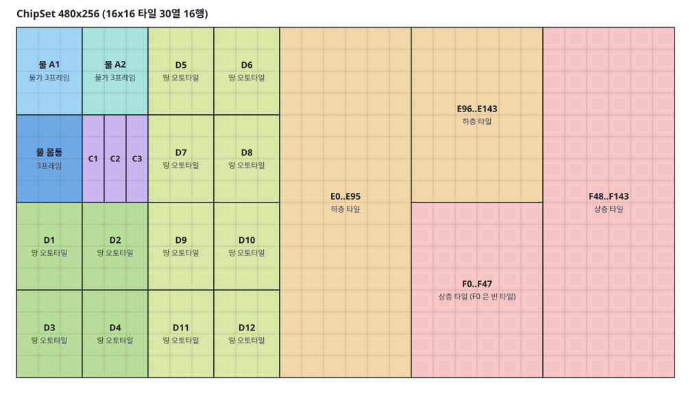
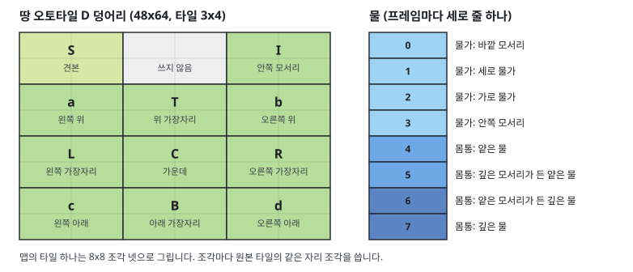

# RPG Maker 2000 ChipSet

ChipSet은 RPG Maker 2000의 타일셋 이미지입니다. 크기는 480x256 픽셀이고, 16x16 타일이 30열 16행으로 들어 있습니다. 에디터는 ChipSet을 엔진이 그리는 타일셋(아틀라스)으로 바꿔 쓰고, RPG Maker 2000과 같은 하층과 상층 팔레트, 땅과 물의 오토타일, 물결과 애니메이션 타일을 제공합니다.

오토타일은 칠한 타일의 모양이 이웃 타일에 따라 정해지는 타일입니다. 같은 오토타일끼리 붙으면 경계가 이어지고, 다른 타일과 만나는 쪽에만 가장자리가 그려집니다.

처음 쓰는 경우 [RPG Maker 2000 맵 따라 만들기](rm2k-tutorial.md)의 절차대로 맵을 한 장 만들어 봅니다. RPG Maker 2000으로 만든 게임의 맵을 옮기는 절차는 [RPG Maker 2000 게임 가져오기 따라 하기](rm2k-import.md)에 있습니다. 이 문서는 각 기능의 규칙과 형식을 설명합니다.

## ChipSet의 구성



| 구역 | 내용 |
|---|---|
| 물 A1, 물 A2 | 물가가 있는 물 오토타일 두 가지. 물가 그림만 다르고, 서로 붙으면 물가 없이 이어집니다 |
| 깊은 물 | 물 오토타일. 얕은 물(A1, A2)과 만나는 모서리가 둥글게 그려집니다 |
| 애니메이션 타일 C1, C2, C3 | 네 프레임을 차례로 보이는 타일 (폭포, 소용돌이). 물과 붙으면 물로 이어집니다 |
| 오토타일 D1에서 D12 | 땅 오토타일 12가지 (풀, 흙, 모래, 돌바닥 등) |
| 하층 타일 E0에서 E143 | 오토타일이 아닌 하층 타일 144개 |
| 상층 타일 F0에서 F143 | 투명한 배경 위에 그린 상층 타일 144개 (나무, 울타리, 간판). F0은 빈 타일입니다 |

땅 오토타일 덩어리 하나는 3x4 타일이고, 물은 프레임마다 세로 줄 하나(물가 넷과 몸통 넷)입니다. 맵의 타일 하나는 이 원본 타일들의 8x8 조각 넷을 모아 그립니다.



투명색은 다음 순서로 정합니다.

1. 팔레트 PNG(색 수 256 이하)이면 팔레트의 0번 색이 투명입니다. RPG Maker 2000과 같은 규칙입니다.
2. 팔레트 PNG가 아니고 투명한 픽셀이 있으면 이미지의 알파를 그대로 씁니다.
3. 투명한 픽셀이 없으면 (288, 128) 픽셀(F0의 왼쪽 위)의 색을 투명으로 봅니다.

## ChipSet으로 맵 만들기

1. ChipSet 이미지(PNG)를 프로젝트의 `resources` 아래에 둡니다. 예: `resources/ChipSet/Exterior.png`
2. **맵 > 새 맵**(Ctrl+Alt+M)을 엽니다.
3. **타일셋**에서 ChipSet 이미지를 선택합니다. 이미지가 480x256이고 타일 크기가 16이면 **형식** 항목이 나타나고 **RPG Maker 2000 ChipSet**이 선택됩니다.
4. **물결**과 **물결 빠르기**를 정합니다.
5. **만들기**를 누릅니다.

| 항목 | 값 | 동작 |
|---|---|---|
| 형식 | RPG Maker 2000 ChipSet | ChipSet을 아틀라스로 바꿔 씁니다 |
| 형식 | 이미지 그대로 | 다른 PNG와 같이 이미지를 그대로 타일셋으로 씁니다. 오토타일과 물결은 없습니다 |
| 물결 | 왕복 | 물의 프레임을 0, 1, 2, 1 순서로 되풀이합니다 (RPG Maker 2000의 기본값) |
| 물결 | 한 방향 | 물의 프레임을 0, 1, 2 순서로 되풀이합니다 |
| 물결 빠르기 | 보통, 빠르게 | 프레임마다 400ms, 200ms |

만들기를 누르면 에디터가 ChipSet을 아틀라스로 바꿔 `resources/tiles/<ChipSet 이름>.rm2k.png`에 쓰고, 그 아틀라스를 타일셋으로 쓰는 맵을 엽니다. 애니메이션 타일은 프레임마다 100ms입니다.

## 팔레트

ChipSet 타일셋의 팔레트는 **하층**과 **상층** 두 쪽입니다. 순서와 배치(6열)는 RPG Maker 2000의 팔레트와 같습니다.

| 쪽 | 타일 순서 |
|---|---|
| 하층 (162개) | 물 A1, 물 A2, 깊은 물, 애니메이션 타일 C1에서 C3, 오토타일 D1에서 D12, 하층 타일 E0에서 E143 |
| 상층 (144개) | 상층 타일 F0에서 F143. F0을 칠하면 타일을 비웁니다 (지우개와 같습니다) |

팔레트 위쪽에 선택한 타일의 이름이 표시되고, 팔레트 위에 마우스를 올리면 그 타일의 이름이 오른쪽에 표시됩니다. 드래그로 여러 타일을 선택하면 그 사각형 모양 그대로 칠합니다. 집이나 큰 나무처럼 여러 타일로 된 그림은 드래그로 선택합니다.

## 오토타일 칠하기

팔레트에서 오토타일을 선택하고 펜, 사각형, 채우기로 칠하면 칠한 타일과 이웃한 오토타일의 모양이 함께 바뀝니다. 한 번의 칠하기(마우스를 누르고 놓을 때까지)가 되돌리기 한 단계이며, 이웃 타일의 모양 변경도 같은 단계에 들어갑니다. 지우개로 지워도 이웃 오토타일의 모양이 다시 맞춰집니다.

모양은 이웃 여덟 타일이 같은 지형인지로 정합니다.

| 오토타일 | 같은 지형으로 보는 이웃 |
|---|---|
| 땅 (D1에서 D12) | 같은 번호의 땅 오토타일. D1과 D2는 서로 다른 지형입니다 |
| 물 (A1, A2, 깊은 물) | 물 A1, 물 A2, 깊은 물, 애니메이션 타일. 물가는 이 밖의 타일과 만나는 쪽에만 그려집니다 |
| 애니메이션 타일 | 모양이 없습니다. 칠하면 첫 프레임의 타일이 들어갑니다 |

- 맵 밖은 같은 지형으로 봅니다. 맵 가장자리에는 가장자리나 물가가 그려지지 않습니다.
- 깊은 물과 얕은 물이 만나는 모서리는 둥글게 그려집니다. 깊은 물은 동서남북 둘과 그 사이의 대각선이 모두 얕은 물인 모서리가, 얕은 물은 동서남북 둘이 깊은 물이고 그 사이의 대각선이 물인 모서리가 둥글어집니다. 곧은 경계는 둥글어지지 않습니다.
- 채우기는 같은 지형의 오토타일을 모양과 관계없이 한 영역으로 봅니다. 물 A1로 된 호수를 물 A2로 채우면 호수 전체가 바뀝니다. 깊은 물은 얕은 물과 다른 지형이라 남습니다.
- 스포이드로 맵의 오토타일을 가져오면 그 지형의 타일이 선택됩니다. 그대로 칠하면 모양이 다시 맞춰집니다.

> **주의**: 모양은 칠할 때만 맞춰집니다. 맵 파일을 텍스트 편집기로 고친 칸은 다시 칠하기 전까지 모양이 바뀌지 않습니다.

## 물결과 애니메이션 타일

엔진은 타일셋의 `animations`에 적힌 대로 물과 애니메이션 타일의 프레임을 바꿔 그립니다. 시계는 게임의 틱마다 지난 시간이므로, 씬의 타일맵 오브젝트로 띄운 맵은 따로 할 일이 없습니다. 스크립트에서 맵을 직접 그리는 게임은 틱마다 `Tilemap.Update(map, elapsed)`(Ruby는 `map.update(elapsed)`)를 불러야 물결이 움직입니다. 부르지 않으면 첫 프레임에 머뭅니다.

에디터의 맵 뷰도 같은 간격으로 프레임을 바꿔 그립니다. 맵 뷰 위쪽의 **애니메이션** 버튼(**맵 > 타일 애니메이션 재생**)을 끄면 게임을 시작할 때의 프레임에서 멈춥니다. 팔레트와 씬 뷰는 늘 시작할 때의 프레임을 보입니다.

## 맵 파일의 타일셋 항목

```json
{
  "image": "resources/tiles/Exterior.rm2k.png",
  "firstGid": 1,
  "columns": 48,
  "animations": [
    { "tile": 864, "count": 3, "frames": [864, 867, 870, 873], "duration": 100 },
    { "tile": 912, "count": 918, "frames": [912, 1872, 2832, 1872], "duration": 400 }
  ],
  "rm2k": { "version": 1, "chipset": "resources/ChipSet/Exterior.png", "water": "pingpong", "waterSpeed": "normal" }
}
```

| 키 | 의미 |
|---|---|
| `image` | 아틀라스 이미지. 48열이고 오토타일은 모양마다 타일 한 개씩 들어 있습니다 |
| `animations` | 엔진이 읽는 타일 애니메이션. `tile`부터 `count`개의 타일이 `frames`의 프레임을 `duration`ms마다 차례로 보입니다 |
| `rm2k` | 에디터가 읽는 키. 원본 ChipSet 경로, 아틀라스 판(`version`), 물결 설정 |

엔진은 `rm2k`를 읽지 않습니다. 아틀라스는 원본 ChipSet에서 다시 만들 수 있습니다.

- 원본 ChipSet 파일이 바뀌면 에디터가 열린 맵의 아틀라스를 다시 만듭니다. 맵 뷰와 팔레트도 새 아틀라스로 다시 그려집니다.
- 맵을 열 때 아틀라스 파일이 없고 원본 ChipSet이 있으면 아틀라스를 만듭니다.

> **주의**: 원본 ChipSet에서 타일의 위치를 옮기면 이미 칠한 타일이 다른 그림을 보입니다. 타일 번호는 ChipSet 안의 위치로 정해지기 때문입니다.

> **주의**: RPG Maker 2000 RTP의 ChipSet과 그 ChipSet으로 만든 아틀라스는 RTP의 사용 조건을 따릅니다. 공개 저장소에 올릴지는 그 조건을 확인하고 정합니다.

## RPG Maker 2000 게임 가져오기

**맵 > 맵 가져오기**는 RPG Maker 2000 게임 폴더의 맵을 이 형식의 맵 파일로 옮깁니다. 절차는 [RPG Maker 2000 게임 가져오기 따라 하기](rm2k-import.md)에 있습니다. 이 절은 옮기는 규칙을 설명합니다.

### 읽는 파일

| 파일 | 읽는 내용 |
|---|---|
| `RPG_RT.ldb` | ChipSet 목록: 이미지 이름, 하층 162개와 상층 144개 타일의 통행, 물결(왕복과 한 방향, 보통과 빠르게) |
| `RPG_RT.lmt` | 맵의 이름. 없으면 `MAP0001`처럼 번호로 부릅니다 |
| `RPG_RT.ini` | 게임 이름(`GameTitle`), `[EasyRPG]` 절의 `Encoding`(코드 페이지 번호)이 있으면 그 인코딩 |
| `MapXXXX.lmu` | 맵의 크기, ChipSet 번호, 하층과 상층의 타일 번호 |
| `ChipSet/<이름>.png`, `.bmp`, `.xyz` | ChipSet 이미지. 같은 이름이 여럿이면 PNG, BMP, XYZ 순서로 고릅니다. 게임 폴더에 없으면 프로젝트의 `resources/ChipSet/<이름>.png`를 씁니다 |

BMP는 압축하지 않은 1, 4, 8, 24, 32비트를 읽습니다. 팔레트 이미지(PNG, BMP, XYZ)는 0번 색을 투명으로 봅니다. BMP와 XYZ는 투명한 픽셀을 알파로 바꾼 PNG로 씁니다.

### 타일 번호

| RPG Maker 2000의 번호 | 타일 | 옮긴 타일 |
|---|---|---|
| 0에서 2999 | 물. 1000마다 물 A1, 물 A2, 깊은 물이고, 그 안에서 50 x 모서리 비트 + 물가 모양 | 같은 모양의 물 |
| 3000, 3050, 3100 | 애니메이션 타일 C1, C2, C3 | 같은 애니메이션 타일 |
| 4000에서 4599 | 땅 D1에서 D12. 4000 + 50 x 번호 + 모양 | 같은 모양의 땅. 모양 47과 48은 가운데 타일, 49는 견본 타일 |
| 5000에서 5143 | 하층 타일 E0에서 E143 | 같은 타일 |
| 10000에서 10143 | 상층 타일 F0에서 F143. 10000(F0)은 빈 타일 | 같은 타일. F0은 빈 칸(0) |

이 밖의 번호는 빈 칸이 되고, 맵 목록의 알림에 개수가 표시됩니다. 모양은 RPG Maker 2000이 저장한 그대로 옮기고 다시 맞추지 않습니다.

### 레이어

RPG Maker 2000은 ChipSet 설정에서 별(캐릭터 위에 표시)이 지정된 타일을 캐릭터 위에 그립니다. 벽이 지정된 하층 타일도 캐릭터 위에 그립니다. 이 순서를 지키기 위해 맵의 레이어를 다음과 같이 나눕니다.

| 레이어 | 타일 |
|---|---|
| `lower` | 별과 벽이 없는 하층 타일 |
| `upper` | 별이 없는 상층 타일 |
| `lower_over` | 별이나 벽이 있는 하층 타일. 해당 타일이 있을 때만 만듭니다 |
| `upper_over` | 별이 있는 상층 타일. 해당 타일이 있을 때만 만듭니다 |

씬의 타일맵 오브젝트는 **오브젝트 아래 레이어 수**를 2로 지정합니다. `lower`와 `upper`가 캐릭터 아래, 나머지가 위에 그려집니다.

### 통행

RPG Maker 2000의 통행은 타일마다 네 방향(아래, 왼쪽, 오른쪽, 위)의 진입 가능 여부입니다. 한 방향의 통행은 다음 순서로 정해집니다.

1. 상층 타일이 그 방향을 막으면 막힙니다.
2. 상층 타일에 별이 없으면 지나갈 수 있습니다 (물 위의 다리).
3. 상층 타일에 별이 있으면(빈 타일 F0 포함) 하층 타일이 정합니다. 벽이 지정된 땅 타일의 윗면 모양은 지나갈 수 있습니다.

엔진의 통행은 지나갈 수 있음(0)과 없음(1) 두 가지라, 네 방향 모두 막힌 타일만 1이 됩니다. 한두 방향만 막힌 타일은 0이 되고, 맵 목록의 알림에 개수가 표시됩니다.

### 텍스트 인코딩

맵 이름과 ChipSet 이름은 게임을 만든 컴퓨터의 코드 페이지로 저장되어 있고, 파일에는 코드 페이지가 적혀 있지 않습니다. **텍스트 인코딩**이 **자동**이면 에디터는 이름들을 후보마다 풀어 보고, 그 언어에서 자주 쓰는 글자(일본어 가나와 한자, 한국어 한글, 중국어 한자, 키릴 문자, 라틴 문자)의 비율이 가장 높은 인코딩을 고릅니다. 이름이 모두 영문이면 서유럽(Windows-1252)입니다.

| 선택지 | 쓰는 게임 |
|---|---|
| 일본어 (Shift_JIS) | 일본어판 RPG Maker 2000으로 만든 게임 |
| 한국어 (CP949) | 한국어 Windows에서 만든 게임 |
| 중국어 간체 (GBK), 중국어 번체 (Big5) | 중국어 Windows에서 만든 게임 |
| 키릴 문자 (Windows-1251) | 러시아어 따위로 만든 게임 |
| 서유럽 (Windows-1252) | 영어판과 서유럽 언어로 만든 게임 |

## 제공하지 않는 것

- 방향별 통행, 카운터, 지형 번호는 맵에 들어오지 않습니다. 새 맵의 통행은 맵의 통행 레이어로 정하고 ([맵](maps.md)의 통행), 가져온 맵의 통행은 네 방향 모두 막힌 타일만 막힙니다.
- 맵 가져오기는 이벤트, 원경 이미지, 맵의 배경 음악과 인카운트를 옮기지 않습니다.
- 새 맵 대화상자는 PNG ChipSet만 고릅니다. XYZ와 BMP는 PNG로 바꿔 쓰거나 맵 가져오기로 옮깁니다.
